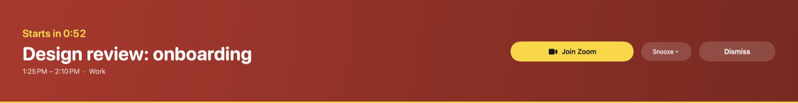
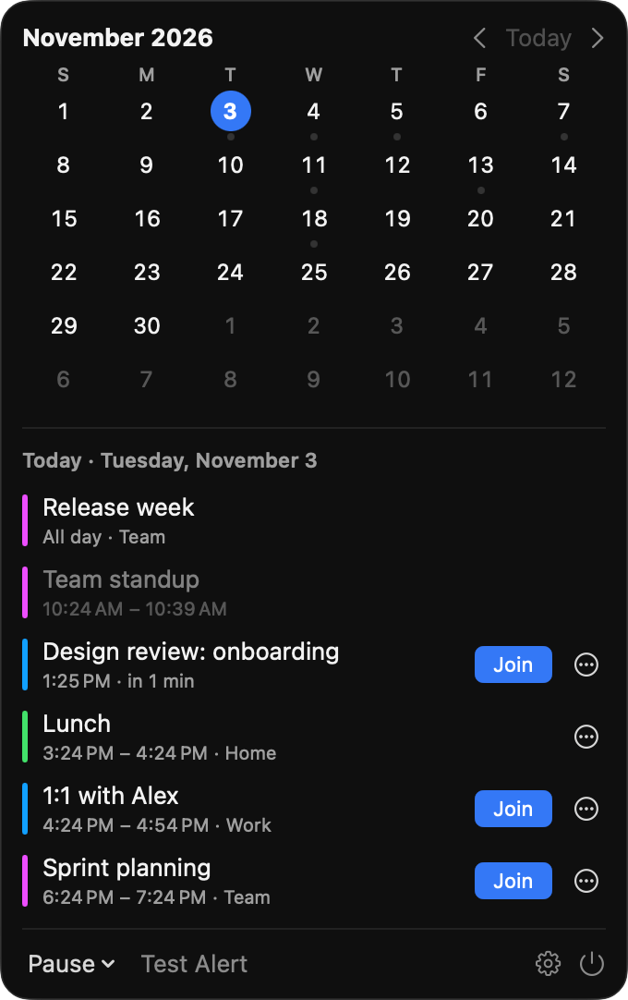
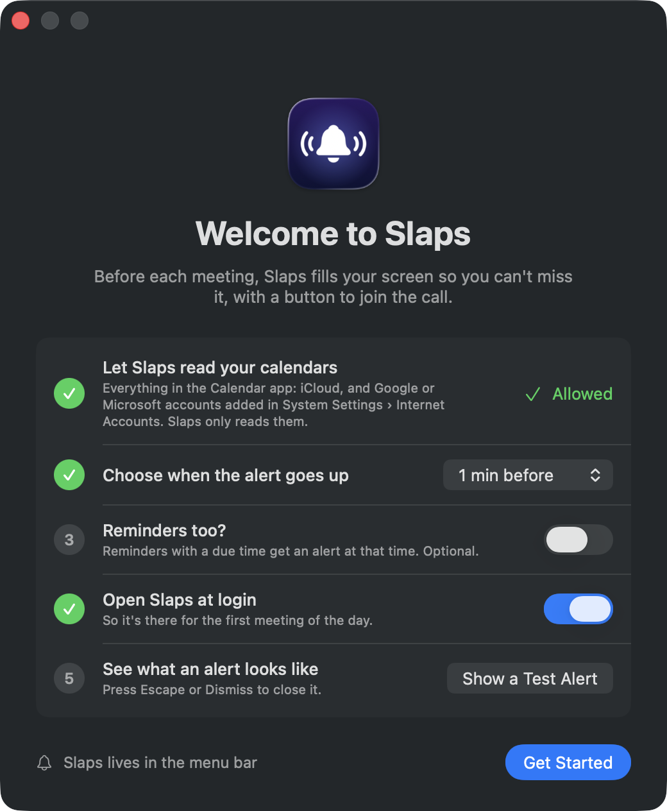
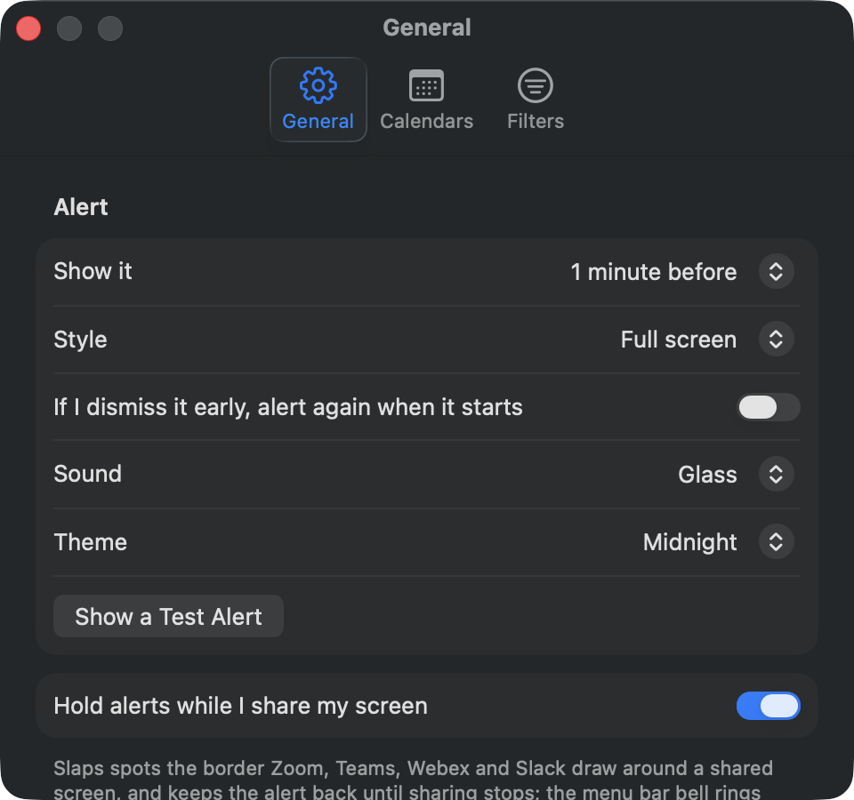

# Slaps

Full-screen meeting alerts you cannot miss. A personal take on [In Your Face](https://www.inyourface.app/).


A minute before a meeting (or however long you choose), Slaps covers every screen, in every Space and over
full-screen apps, with the meeting's title, a countdown and a **Join** button for its video call. Return joins, Escape
dismisses, or snooze it for 1 or 5 minutes or until it starts. Optionally, an alert dismissed early comes back
when the meeting starts.

Or, if a whole screen is too much, a **banner** across the top or bottom fifth of each screen, above everything but
leaving the rest usable, or a **card at the side**: the top right of the main screen, under the menu bar, like a
notification that stays. Neither takes the keyboard from what you're typing in; click its buttons, or use ⌃⌥⌘J and
⌃⌥⌘D.



- **Calendars:** everything in macOS's Calendar app, through EventKit: iCloud, and Google, Microsoft 365 or Exchange
  accounts added in System Settings › Internet Accounts. Turn calendars on and off in Settings.
- **Call links:** Zoom, Google Meet, Teams, Webex, FaceTime, Slack huddles, Whereby, Jitsi, Chime, GoTo and more, found
  in the event's URL, location or notes (`Sources/SlapsKit/MeetingLink.swift`).
- **Filters:** skip all-day events, declined ones, ones with nobody else invited, ones without a call link, or titles
  containing words you list.
- **Reminders:** optionally, reminders with a due time (or only high-priority ones) get an alert at that time, with
  Mark Done.
- **A video instead of a chime:** optionally, each alert plays a random YouTube video, with sound: from videos,
  playlists and channels you list, or from [ytroulette.com](https://ytroulette.com) in a category you pick (its picks
  aren't screened). The next one is fetched ahead of time, so an alert never waits for it.
- **Low battery:** optionally, an alert when a MacBook's battery runs down to a level you pick (5–50%), once each time,
  in the same style and theme. Plugging in takes it away.
- **Per-event overrides:** from an event's ⋯ menu, no alert or a different lead time, for that occurrence or every
  occurrence of a repeating event.
- **Screen sharing:** alerts are held back while Zoom, Teams, Webex or Slack shares your screen (it spots the border
  they draw; a browser tab share isn't detected), and the alert is kept out of screen capture where macOS allows.
- **Shortcuts from any app:** ⌃⌥⌘J joins the current or next meeting, ⌃⌥⌘D dismisses the alert, ⌃⌥⌘P pauses for an
  hour or resumes. An alert ignores keys for its first 1.5 seconds, so typing elsewhere can't join or dismiss it.
- **Menu bar:** a month calendar with a dot on busy days, the chosen day's agenda with Join buttons, minutes to the
  next meeting (and the date, if you like), pause (30 min, 1 or 2 hours, until tomorrow) and a test alert.
- **Settings:** lead time, full screen or a banner at the top or bottom, sound, theme (Midnight, Ember, Forest,
  Paper, or Custom: your own background and accent colours, with text that reads on them), open at login.
- **Welcome window** on first launch: calendar access, when to alert, reminders, open at login and a test alert,
  as a checklist. Settings › General opens it again.

<table>
  <tr>
    <td align="center"></td>
    <td align="center"></td>
  </tr>
  <tr>
    <td align="center">The menu bar: the month, and the day's meetings</td>
    <td align="center">The welcome window, on first launch</td>
  </tr>
</table>

<p align="center"></p>

## Install

Slaps needs macOS 14 or later. Download it from [apps.phin.tech](https://apps.phin.tech)
([the latest zip](https://apps.phin.tech/Slaps/latest.zip)) or the
[GitHub releases](https://github.com/phin-tech/slaps/releases/latest), unzip it, and move Slaps to Applications. It's
notarized by Apple, so it opens without a warning, and it updates itself (Settings › General › Updates).

Slaps lives in the menu bar, with no Dock icon. On first launch the welcome window walks through calendar access and
the rest; quit it from the popover's ⏻ button.

### From source

Build it with Xcode 26.6 or later, [xcodegen](https://github.com/yonaskolb/XcodeGen), [just](https://just.systems)
and [uv](https://docs.astral.sh/uv/) (`brew install xcodegen just uv`):

```sh
git clone https://github.com/phin-tech/slaps.git && cd slaps
just install
```

`just install` builds Slaps signed for development, puts it in `/Applications` in place of any copy there, and opens
it. Run it again after pulling changes. It signs with the team in `Signing.local.xcconfig` (gitignored; see
`Signing.xcconfig`); without one, the build is signed to run only on this Mac and macOS asks for calendar access again
after every install.

`just install` runs [app-release](https://git.phin.tech/sam/app-release), which is private. Without access to it,
`just run` builds a Debug copy and opens it from Xcode's build folder.

## Other apps

Scripts, Shortcuts, Raycast or any app can put up an alert, and pause or resume Slaps, with a `slaps://` URL or
AppleScript. Turn it off in Settings › General.

```sh
open -g "slaps://alert?title=Deploy%20done"                                  # now
open -g "slaps://alert?title=Standup&in=5&link=https://zoom.us/j/123"         # in 5 minutes, with a Join button
open -g "slaps://alert?title=Call%20Mum&at=2026-11-03T18:00:00Z&source=Script" # at a time; source= says who asked
open -g "slaps://pause?minutes=30"     # pause (default an hour)
open -g "slaps://resume"
open -g "slaps://alert?title=Build%20failed&id=ci-42&style=banner"         # an id, and a style of its own
open -g "slaps://dismiss"              # the alert on screen
open -g "slaps://dismiss?id=ci-42"     # the one sent with that id, up or still to come
open -g "slaps://join"                 # the alert's call, or a meeting under way or within 10 minutes
```

```applescript
tell application "Slaps"
    show alert "Deploy done" in minutes 5 link "https://ci.example.com/run/42" notes "All green" from "CI"
    show alert "Call Mum" at date "Tuesday, 3 November 2026 at 18:00"
    pause alerts for minutes 30
    resume alerts
    show alert "Build failed" id "ci-42" style "banner"
    dismiss alert
    dismiss alert id "ci-42"
    join meeting
end tell
```

An alert sent again with the same `id` takes the old one's place, and goes up again even if that one was dismissed.
`style` is `fullscreen`, `banner` (the top), `top`, `bottom` or `side`, over the setting, for that alert only.

An alert can be answered from its buttons: `actions` lists up to three, and `callback` is the URL each opens, with
`{action}` where its words go, encoded as one value:

```sh
open -g "slaps://alert?title=Rotate%20the%20key%3F&actions=Yes,No&callback=boiler-room%3A%2F%2Fanswer%3Fquestion%3D3%26answer%3D%7Baction%7D"
```

Anyone can send an alert, so its link and buttons open only web pages or an app Slaps knows answers alerts
(`ExternalAlert.apps`: Boiler Room's `boiler-room:` for now), whose button
names it: Open in Boiler Room.

`at` takes ISO 8601 (a time without a zone is local). An alert from another app is at most a week ahead, says where
it came from, and only takes an `http` or `https` link, whose site its button names, or one of those apps'. A URL that can't be run is noted
in the log (`log stream --process Slaps`); AppleScript gets the reason as an error. These alerts aren't kept if Slaps
quits.

## Develop

```sh
just run     # needs Xcode and xcodegen
just test
just debug-app && just debug alert && just debug snapshot /tmp/alert.png   # look at the alert
just debug popover && just debug snapshot /tmp/popover.png                 # and the menu bar popover
just screenshots   # remake docs/screenshots, from a Debug build showing made-up meetings (SLAPS_DEMO=1)
```

See [DEVELOPMENT.md](DEVELOPMENT.md).
